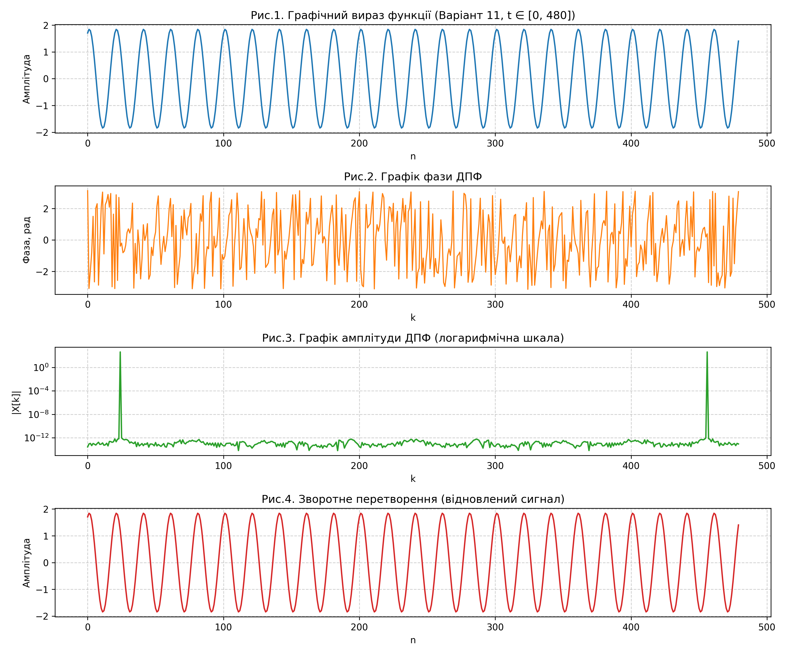

# Лабораторна робота №7: Дискретне перетворення Фур’є (ДПФ)

Лабораторна робота з дисципліни **«Цифрова обробка інформації» (ЦОІ)**.  
**Виконав:** студент групи ФеП-32 Чепара С.  
**Варіант:** 11  

---

## Мета роботи

Ознайомитися з основами теорії дискретно-неперервного та дискретного перетворення Фур’є (ДПФ). Реалізувати алгоритми прямого та оберненого ДПФ у середовищі Python для спектрального аналізу періодичного модельного сигналу згідно з Варіантом 11 на часовому інтервалі $t \in [0, 480]$. Дослідити періодограму (амплітудний і фазовий спектри), проаналізувати явище ермітової дзеркальної симетрії (муаровий ефект) та експериментально оцінити похибку реконструкції сигналу за допомогою ОДПФ.

---

## Розрахункові формули та модельний сигнал

| № | Назва | Математичний вираз | Призначення |
|---|-------|-------------------|-------------|
| (1) | Пряме ДПФ | $X[k] = \sum_{n=0}^{N-1} x[n] e^{-j \frac{2\pi}{N} kn}, \quad k = 0, \dots, N-1$ | Обчислення комплексного спектра |
| (2) | Обернене ДПФ (ОДПФ) | $x[n] = \frac{1}{N} \sum_{k=0}^{N-1} X[k] e^{j \frac{2\pi}{N} kn}, \quad n = 0, \dots, N-1$ | Точне відновлення часового сигналу |
| (3) | Амплітудний спектр | $\|X[k]\| = \sqrt{\text{Re}(X[k])^2 + \text{Im}(X[k])^2}$ | Модуль гармонійних складових |
| (4) | Фазовий спектр | $\arg(X[k]) = \text{atan2}(\text{Im}(X[k]), \text{Re}(X[k]))$ | Фазовий зсув кожної гармоніки |
| (5) | Симетрія дійсного сигналу | $X[N - k] = X^*[k] \implies \|X[N - k]\| = \|X[k]\|$ | Ермітова парність відносно $k = N/2$ |
| (6) | Сигнал (Варіант 11) | $X(t) = \sin\left(\frac{2\pi t}{20} + \frac{\pi}{4}\right) + \sin\left(\frac{2\pi t}{20} + \frac{\pi}{2}\right)$ | Вихідний модельний ряд ($t \in [0, 480]$) |
| (7) | Аналітичне спрощення | $X(t) = 2\cos\left(\frac{\pi}{8}\right) \sin\left(\frac{2\pi t}{20} + \frac{3\pi}{8}\right) \approx 1.8478 \sin(0.1\pi t + 1.1781)$ | Еквівалентна моногармоніка ($f_0 = 0.05$ Гц) |

---

## Результати спектрального аналізу

| Параметр | Теоретичне значення | Експеримент (Python) | Примітка |
|----------|---------------------|----------------------|----------|
| Кількість відліків $N$ | 480 | 480 | Крок $\Delta t = 1$ |
| Період коливання $T_0$ | 20.0 відліків | 20.0 відліків | $480 / 20 = 24$ повні періоди |
| Циклічна частота $f_0$ | 0.0500 Гц | 0.0500 Гц | $f_0 = 1 / T_0$ |
| Базисний спектральний пік $k$ | $k_0 = 24$ | $k_0 = 24$ | $k_0 = N \cdot f_0$ |
| Дзеркальний пік $N - k_0$ | 456 | 456 | Ермітове відображення |
| Нормована амплітуда $2\|X\|/N$ | $2\cos(\pi/8) \approx 1.8478$ | 1.8478 | Повний збіг до $10^{-4}$ |
| Фаза спектрального піку | $-\pi/8 \approx -0.3927$ рад | -0.3927 рад | Зсув відносно косинуса |
| Максимальна похибка ОДПФ | 0.00 | $1.33 \times 10^{-15}$ | Рівень машинної точності `float64` |

---

## Графічні результати

Зведений 4-компонентний графік моделювання та ДПФ аналізу сигналу:



---

## Структура проекту

```text
.
├── ЦОІ ЛАБ7 ДПФ.docx        # Методичні вказівки кафедри
├── lab7.py                   # Програма виконання роботи (ДПФ, ОДПФ, побудова спектрів)
├── Lab7_report.docx          # Академічний звіт з формулами OfficeMath (шапка з Лаб 6)
├── Lab7_report.pdf           # Експортований PDF-звіт для швидкого перегляду
├── requirements.txt          # Залежності проекту
├── README.md                 # Короткий звіт та опис проекту
├── .gitignore                # Файли виключення для git
└── output/                   # Згенеровані графіки високої чіткості
    ├── dft_variant11_summary.png  # Зведений графік 4-в-1 (відповідає рисунку з методички)
    ├── fig1_signal.png            # Рис. 1. Початковий сигнал X(t)
    ├── fig2_phase.png             # Рис. 2. Фазовий спектр ДПФ
    ├── fig3_amplitude.png         # Рис. 3. Амплітудний спектр (періодограма)
    └── fig4_reconstructed.png     # Рис. 4. Відновлений сигнал після ОДПФ
```

---

## Встановлення та запуск

```bash
# 1. Встановлення залежностей
pip install -r requirements.txt

# 2. Запуск програми спектрального аналізу
python3 lab7.py
```
