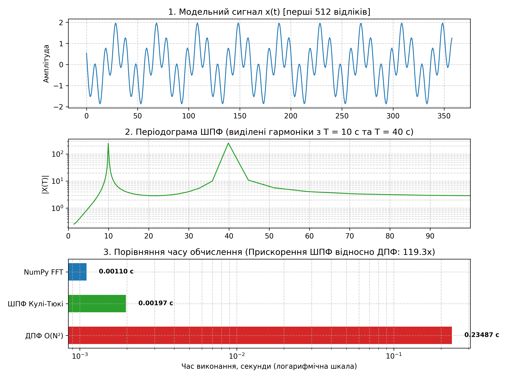

# Лабораторна робота №8: Швидке дискретне перетворення Фур’є (ШПФ)

Лабораторна робота з дисципліни **«Цифрова обробка інформації» (ЦОІ)**.
**Виконав:** студент групи ФеП-32 Чепара С.
**Варіант:** 11

---

## Мета роботи

Ознайомитися з основами теорії швидкого перетворення Фур’є (ШПФ) за алгоритмом Кулі-Тюкі з прорідженням у часі (Radix-2 DIT FFT). Дослідити алгебраїчні властивості комплексного поворотного множника $W_N^k$. Реалізувати алгоритми прямого ШПФ, класичного ДПФ та зворотного ШПФ (ОШПФ) у середовищі Python для спектрального аналізу двочастотного гармонійного сигналу $X(t) = \cos(2\pi t / 10 + 1) + \cos(2\pi t / 40 + \pi / 2)$ на часовому інтервалі $t \in [0, 480)$ при кроці дискретизації $\Delta t = 0.7$ с ($N = 512$ відліків). Провести хронометраж виконання, експериментально підтвердити зниження обчислювальної складності з $O(N^2)$ до $O(N \log_2 N)$ та порівняти результати з лабораторною роботою №7.

---

## Розрахункові формули та модельний ряд

| №   | Назва                                  | Математичний вираз                                                                                           | Призначення                                                          |
| ---- | ------------------------------------------- | ----------------------------------------------------------------------------------------------------------------------------- | ------------------------------------------------------------------------------- |
| (1)  | Пряме ДПФ                           | $X[k] = \sum_{n=0}^{N-1} x[n] e^{-j \frac{2\pi}{N} kn}, \quad k = 0, \dots, N-1$                                            | Базове спектральне перетворення $O(N^2)$         |
| (2)  | Обернене ДПФ (ОДПФ)          | $x[n] = \frac{1}{N} \sum_{k=0}^{N-1} X[k] e^{j \frac{2\pi}{N} kn}, \quad n = 0, \dots, N-1$                                 | Відновлення часового сигналу                          |
| (3)  | Поворотний множник         | $W_N^{kn} = e^{-j \frac{2\pi}{N} kn}$                                                                                       | Базисне ядро перетворення Фур’є                     |
| (4)  | Властивості $W_N$              | $W_N^{k+N} = W_N^k, \quad W_N^{k+N/2} = -W_N^k, \quad W_N^{2k} = W_{N/2}^k$                                                 | Періодичність, антисиметрія, редукція          |
| (5)  | Прорідження у часі          | $x_1[m] = x[2m], \quad x_2[m] = x[2m+1], \quad m = 0, \dots, \frac{N}{2}-1$                                                 | Розбиття на парні та непарні відліки             |
| (6)  | Декомпозиція ДПФ             | $X[k] = X_1[k] + W_N^k X_2[k]$                                                                                              | Зведення до двох ДПФ довжини $N/2$                    |
| (7)  | Операція «метелик»         | $\begin{cases} X[k] = X_1[k] + W_N^k X_2[k] \\ X[k + N/2] = X_1[k] - W_N^k X_2[k] \end{cases}, \quad 0 \le k < \frac{N}{2}$ | Обчислення пари спектральних коефіцієнтів |
| (8)  | Базовий метелик ($N=2$)     | $X[0] = x[0] + x[1], \quad X[1] = x[0] - x[1]$                                                                              | Базовий випадок зупинки рекурсії                   |
| (9)  | Обернене ШПФ (ОШПФ)          | $x[n] = \frac{1}{N} \left( \mathcal{FFT}(X^*) \right)^*$                                                                    | Реконструкція через спряженість                    |
| (10) | Теоретичне прискорення | $S = \frac{C_{\text{ДПФ}}}{C_{\text{ШПФ}}} = \frac{N^2}{\frac{N}{2} \log_2 N} = \frac{2N}{\log_2 N}$                  | Аналітичний виграш за кількістю множень      |
| (11) | Модельний ряд                   | $X(t) = \cos\left(\frac{2\pi t}{10} + 1\right) + \cos\left(\frac{2\pi t}{40} + \frac{\pi}{2}\right)$                        | Вихідний сигнал ($t \in [0, 480)$, $\Delta t = 0.7$ с)       |
| (12) | Частота та період            | $\nu_k = \frac{k}{N \cdot \Delta t}, \quad T_k = \frac{1}{\nu_k} = \frac{N \cdot \Delta t}{k}$                              | Розрахунок фізичного періоду гармонік         |

---

## Результати порівняльного аналізу (ДПФ vs ШПФ)

| Параметр дослідження                          | Теоретичне значення         | Експеримент (Python)              | Примітка                                               |
| ---------------------------------------------------------------- | --------------------------------------------- | -------------------------------------------- | -------------------------------------------------------------- |
| Кількість відліків $N$                        | 512 ($2^9$)                                 | 512                                          | Вибірка $x[:512]$                                     |
| Крок дискретизації $\Delta t$                 | 0.70 с                                       | 0.70 с                                      | Формула (12) методички                         |
| Загальна тривалість спостереження | $T_{\max} = 358.4$ с                       | 358.4 с                                     | $N \cdot \Delta t = 512 \cdot 0.7$                           |
| Перша гармоніка: період $T_1$              | 10.00 с                                      | 9.96 с                                      | Пік $k_1 = 36$ ($\nu_1 = 0.1004$ Гц)                  |
| Перша гармоніка: амплітуда $\|X[k_1]\|$ | $N \cdot A_1 / 2 = 256.00$                  | 245.07                                       | Вплив дискретної сітки                     |
| Друга гармоніка: період $T_2$              | 40.00 с                                      | 39.82 с                                     | Пік $k_2 = 9$ ($\nu_2 = 0.0251$ Гц)                   |
| Друга гармоніка: амплітуда $\|X[k_2]\|$ | $N \cdot A_2 / 2 = 256.00$                  | 255.31                                       | Висока точність збігу з сіткою       |
| Час виконання ДПФ ($O(N^2)$)                    | 262 144 множень                        | 0.21618 с                                   | Класичний вкладений цикл                 |
| Час виконання ШПФ (Кулі-Тюкі)             | 2 304 метелики                        | 0.00175 с                                   | Рекурсивний DIT Radix-2                             |
| Час бібліотечного `numpy.fft`                  | Векторизований C (PocketFFT)    | 0.00191 с                                   | Вбудована бібліотека                        |
| Коефіцієнт прискорення ШПФ / ДПФ      | $2N / \log_2 N = 113.78\times$              | 123.44x                                      | Повний збіг з теоретичною оцінкою |
| Порівняння з Лаб 7 ($N=480$, ДПФ)             | $480^2 = 230\,400$ оп. ($\sim 0.18$ с) | ШПФ швидше у $\approx 100\times$ | Порівняно з ДПФ Лаб 7                          |
| Максимальна похибка ОШПФ                   | 0.00                                          | $8.88 \times 10^{-16}$                     | Рівень машинної точності `float64`     |
| Максимальна різниця $\|ДПФ - ШПФ\|$    | 0.00                                          | $3.15 \times 10^{-11}$                     | Числова ідентичність спектрів       |

---

## Графічні результати

Зведений 3-панельний графік моделювання, періодограми та швидкодії алгоритмів:



---

## Структура проекту

```text
.
├── ЦОІ Лаб8 ШПФ.docx        # Методичні вказівки кафедри
├── lab8.py                   # Програма виконання роботи (ШПФ Кулі-Тюкі, ДПФ, ОШПФ)
├── Lab8_report.docx          # Академічний звіт з формулами OfficeMath (шапка з Лаб 7)
├── Lab8_report.pdf           # Експортований PDF-звіт для швидкого перегляду
├── requirements.txt          # Залежності проекту
├── README.md                 # Короткий звіт та опис проекту
├── .gitignore                # Файли виключення для git
└── output/                   # Згенеровані графіки високої чіткості
    ├── fig1_signal.png            # Рис. 1. Початковий модельний сигнал X(t)
    ├── fig2_twiddle.png           # Рис. 2. Дійсна та уявна частини поворотного множника W_N^k
    ├── fig3_dft_periodogram.png   # Рис. 3. Періодограма та фаза класичного ДПФ
    ├── fig4_fft_periodogram.png   # Рис. 4. Періодограма та фаза ШПФ Кулі-Тюкі
    ├── fig5_reconstructed.png     # Рис. 5. Відновлення сигналу (ОШПФ) та похибка
    └── fig6_summary.png           # Рис. 6. Зведене порівняння та діаграма часу виконання
```

---

## Встановлення та запуск

### 1. Запуск через віртуальне оточення venv (Linux / macOS)

```bash
# Створення віртуального оточення
python3 -m venv .venv

# Активація оточення
source .venv/bin/activate

# Встановлення залежностей
pip install -r requirements.txt

# Запуск лабораторної роботи
python lab8.py
```

### 2. Запуск через venv на Windows

```cmd
:: Створення віртуального оточення
python -m venv .venv

:: Активація оточення
.venv\Scripts\activate

:: Встановлення залежностей
pip install -r requirements.txt

:: Запуск лабораторної роботи
python lab8.py
```

### 3. Швидкий запуск без активації shell

```bash
.venv/bin/python3 lab8.py
```
